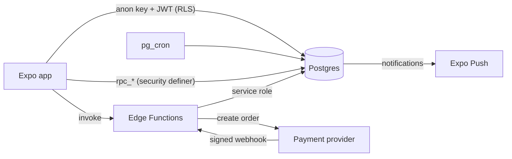

# KaamSetu

A two-sided mobile app where businesses hire freelancers with milestone payments held in escrow, signed agreements, progress check-ins, dispute resolution and reliability scores. Finishing the work should always pay better than disappearing.

Built with Expo (SDK 58, Expo Router, TypeScript strict, NativeWind) and Supabase (Postgres with RLS, Auth, Storage, Realtime, Edge Functions, pg_cron).

> Build status: **Phase 1 (foundation)**. See [PLAN.md](PLAN.md) for the full plan, the decisions taken and the phase roadmap.

## Prerequisites

- Node.js ≥ 22.13 (24 LTS recommended)
- Docker Desktop, running (local Supabase)
- iOS Simulator (Xcode) or an Android emulator, or a device with a development build

The Supabase CLI and Deno are installed as dev dependencies. Use `npx supabase` and `npx deno`.

## Local setup

```bash
npm install
```

```bash
cp supabase/.env.example supabase/.env
```

```bash
npm run db:start
```

Copy the `API URL` and `anon key` printed by `npx supabase status` into `.env.local`:

```bash
cp .env.example .env.local
```

```bash
npm run start
```

Sign in with the local test phone numbers `9000000001` to `9000000009`. The code is always `123456`. These numbers are configured in `supabase/config.toml`, and only for local development. `9000000009` is seeded as an **admin**.

## Environment variables

| Variable                                | Where                                    | Purpose                                                             |
| --------------------------------------- | ---------------------------------------- | ------------------------------------------------------------------- |
| `EXPO_PUBLIC_SUPABASE_URL`              | `.env.local` (app)                       | Supabase API URL                                                    |
| `EXPO_PUBLIC_SUPABASE_ANON_KEY`         | `.env.local` (app)                       | Public anon key (RLS enforces access)                               |
| `EXPO_PUBLIC_APP_ENV`                   | `.env.local` (app)                       | `development` · `staging` · `production`                            |
| `SUPABASE_AUTH_SMS_TWILIO_*`            | `supabase/.env`                          | SMS provider for phone OTP (dummy values locally)                   |
| `YOUPI_*`, `KYC_HASH_PEPPER`, `APP_ENV` | `supabase/.env` / `supabase secrets set` | Server-only secrets for edge functions. Never put these in the app. |

## Scripts

| Command                  | What it does                                                      |
| ------------------------ | ----------------------------------------------------------------- |
| `npm run check`          | Lint, typecheck, format check and Jest (what CI runs for the app) |
| `npm test`               | Jest unit and component tests                                     |
| `npm run test:db`        | pgTAP database tests (RLS, state machine, ledger)                 |
| `npm run test:functions` | Deno tests for edge functions                                     |
| `npm run db:reset`       | Re-apply all migrations and `seed.sql`                            |
| `npm run db:types`       | Regenerate `types/database.ts` from the local schema              |

## Project layout

```
app/              Expo Router routes: (auth), onboarding, client, freelancer, admin, (shared)
components/ui/    Shared, themed UI primitives
features/<name>/  Data hooks (TanStack Query) and feature components
lib/              Supabase client, query client, env
shared/           Zod schemas, constants and money helpers shared with edge functions
types/            Generated database types
supabase/         Migrations, pgTAP tests, edge functions, seed
```

## Architecture



Money and state transitions are decided only on the server. The app never marks a payment as successful.
